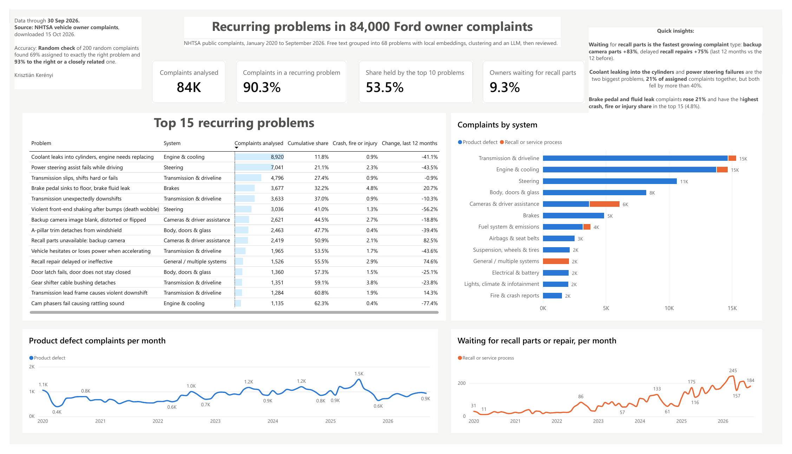

# NHTSA complaint clustering

I turned 84,000 free text vehicle complaints into a ranked list of recurring problems, using a local embedding model, HDBSCAN clustering, a local LLM (Ollama) for readable labels, a review of every label, a manual accuracy check and a Power BI report. Everything runs offline.



## The question

A service quality team receives thousands of free text complaints, and category codes miss a lot of them. Which recurring problems take the most effort, which are growing, and which are parts or process problems rather than product defects?

The project is framed as Ford's own service quality team reviewing its field complaints. The data is public; the method carries over to service reports, field tickets and warranty claims.

## Data

[NHTSA vehicle owner complaints](https://www.nhtsa.gov/nhtsa-datasets-and-apis), flat files `COMPLAINTS_RECEIVED_2020-2024` and `COMPLAINTS_RECEIVED_2025-2026`. Column layout: [`CMPL.txt`](https://static.nhtsa.gov/odi/ffdd/cmpl/CMPL.txt).

| | |
|---|---|
| Source, all manufacturers | 428,906 complaints, January 2020 to October 2026 |
| In scope | Ford Motor Company (Ford, Lincoln, Mercury), vehicles only, January 2020 to September 2026 |
| Complaints analysed | 83,992, no sampling |
| Texts embedded | 81,376 (after removing 1,756 duplicate texts and 860 texts under five words) |

Personal fields (vehicle operator name, city, VIN, dealer details) are dropped when the files are loaded. Raw data is not in this repo; step 1 rebuilds everything from the NHTSA files.

## Pipeline

| Step | Script | What it does |
|---|---|---|
| 1 | `step1_explore.py` | Loads the tab delimited files, drops personal fields, profiles volume, text length, codes and severity. |
| 2 | `step2_clean.py` | Scopes to Ford, strips the hotline template, redaction notices and recall numbers, masks the model name, splits complaints and component codes into two tables. |
| 3 | `step3_embed_cluster.py` | Embeds each text with `all-MiniLM-L6-v2`, reduces with UMAP, clusters with HDBSCAN, then lets noise points join their nearest cluster if cosine similarity is at least 0.60. |
| 4 | `step4_label_clusters.py` | Sends 12 example complaints and the top keywords of each cluster to `qwen3.5:4b` on Ollama, which returns a label, description, system and issue type as JSON. |
| | `label_review.csv` | My review of every LLM label: 47 of 89 kept, 41 corrected, one set by rule. 89 clusters merged into 68 named problems. |
| 5 | `step5_export_powerbi.py`, `step5_measures.dax` | Star schema for Power BI (fact, problem, cluster, component bridge, severity, date) and the DAX measures. |
| 6 | `step6_accuracy_sample.py`, `step6_accuracy_score.py` | Draws 200 random complaints for a manual accuracy check and scores the result. |

The report is `Ford_Customer_Complaints.pbix` (also as [PDF](docs/dashboard.pdf)). A one-page summary is in [docs/one_pager.pdf](docs/one_pager.pdf).

## Decisions that mattered

- **Strip the hotline template.** A third of Ford complaints come through the NHTSA hotline, where staff write them from a template ("The contact owns a… The manufacturer was not notified…"). Left in, the clusters grouped complaints by who wrote them, not by what broke. After cleaning, hotline texts went from a median of 101 words to 59 while web texts barely changed (76 to 74).
- **Mask the model name.** "F-150" in the text pulled complaints together by vehicle. Replacing it with "the vehicle" makes clusters form around the failure; the model stays a filter in the report.
- **No sampling.** The small recurring problems are the point of clustering, and sampling drops them first.
- **Cap the cluster size at 3,000.** Without it, HDBSCAN returned one transmission cluster of 14,000 complaints, which only repeats the NHTSA code.
- **Local models only.** Embeddings and labels run on the laptop, so the same pipeline works on confidential service data.
- **Review every LLM label.** The model was useful but not reliable on its own: it marked the largest brake cluster as a recall issue when only 22% of its complaints mention a parts delay, and split one engine failure (coolant leaking into the cylinders) into seven clusters with different wording.
- **Severity as the impact proxy.** Public data has no repair cost or hours, so complaints are weighted by outcome: injury or death 10, crash or fire 5, towed 2, other 1. The weights sit in their own table and can be changed.

## Results

- **90.3% of complaints fall into one of 68 recurring problems.** The ten largest hold 53.5% of them.
- **9.3% of complaints are owners waiting for recall parts or repairs**, not a new failure. This is the fastest growing complaint type: backup camera recall parts +83% and delayed recall repairs +75% over the last 12 months against the 12 before. It is a parts logistics problem and needs a different owner than a design fault.
- **The text routes what the codes cannot.** 5,306 complaints carry only the NHTSA code "UNKNOWN OR OTHER"; 86% of them were assigned to a named problem.
- **Brake complaints are the one to watch:** up 21% and the highest crash, fire or injury share in the top 15.

| # | Problem | Complaints | Crash, fire or injury | Change vs prior 12 months |
|---|---|---:|---:|---:|
| 1 | Coolant leaks into cylinders, engine needs replacing | 8,920 | 0.9% | -41% |
| 2 | Power steering assist fails while driving | 7,041 | 2.3% | -44% |
| 3 | Transmission slips, shifts hard or fails | 4,796 | 0.9% | -1% |
| 4 | Brake pedal sinks to floor, brake fluid leak | 3,677 | 4.8% | +21% |
| 5 | Transmission unexpectedly downshifts | 3,633 | 0.9% | -10% |
| 6 | Violent front-end shaking after bumps (death wobble) | 3,036 | 1.3% | -56% |
| 7 | Backup camera image blank, distorted or flipped | 2,621 | 2.7% | -19% |
| 8 | A-pillar trim detaches from windshield | 2,463 | 0.4% | -39% |
| 9 | Recall parts unavailable: backup camera | 2,419 | 2.1% | +83% |
| 10 | Vehicle hesitates or loses power when accelerating | 1,965 | 1.7% | -44% |

## How accurate is it?

200 random complaints were checked by hand against the problem they were assigned to (`accuracy_review.xlsx`, results in `accuracy_results.txt`). The sample takes 100 complaints that HDBSCAN placed inside a cluster and 100 that joined their nearest cluster afterwards; rows were shuffled so the reviewer could not tell which was which.

| | Complaints | Exactly right | Right or closely related | Wrong |
|---|---:|---:|---:|---:|
| Inside a cluster | 50,562 | 72% | 95% | 5% |
| Joined nearest cluster | 25,251 | 62% | 89% | 11% |
| **Weighted overall** | **75,813** | **69%** (95% CI 62 to 75%) | **93%** (89 to 97%) | **7%** |

Most "closely related" cases are overlapping problems rather than model errors: brake booster against brake fluid leak, and three transmission problems that blur into each other.

**Cutoff trade-off.** Among complaints that joined their nearest cluster, the wrong ones had a median similarity of 0.63 against 0.73 for the right ones. Raising the cutoff from 0.60 to 0.65 would roughly halve the wrong share in that group (11% to about 5%, from 81 sample rows) but drop about 5,000 complaints, taking coverage from 90.3% to about 84%. I kept 0.60 because the report is about volumes, where coverage matters more than a few percent of noise.

## Limits

- **No cost or hours per case.** Effort is approximated by severity weighted volume. With real service data, hours or cost per case plug straight in.
- **No customer ID and only a partial VIN.** A repeat is defined as the same problem across a model and year cohort, persisting month over month. With real data, the equipment serial number does this directly.
- **Self reported and unverified.** The results show where to look, not proven root causes.

## Run it yourself

Python 3.10 or newer and [Ollama](https://ollama.com) for step 4. Download the two complaint files and `CMPL.txt` from the NHTSA page into this folder, then:

```
pip install -r requirements.txt
python step1_explore.py COMPLAINTS_RECEIVED_2020-2024.txt COMPLAINTS_RECEIVED_2025-2026.txt
python step2_clean.py
python step3_embed_cluster.py
ollama pull qwen3.5:4b
python step4_label_clusters.py
python step5_export_powerbi.py
```

The first run of step 3 downloads the embedding model (about 90 MB) and embeds all texts on the CPU; later runs reuse the cache. Step 5 reads `label_review.csv`, the human review of the labels. To repeat the accuracy check, run `step6_accuracy_sample.py`, fill in `accuracy_review.xlsx`, then run `step6_accuracy_score.py`.

## Next steps

- Merge the overlapping transmission and brake problems, then check accuracy again on a fresh sample.
- Early warning check: compare each problem's monthly complaints with Ford's recall dates from the NHTSA recall file, to see how many months earlier the rise was visible.
- A monthly alert for problems that grow faster than their own history.

## Author

Krisztián Kerényi, Budapest. Business and data analyst, MSc in Artificial Intelligence and Analytics (ESMT Berlin).
